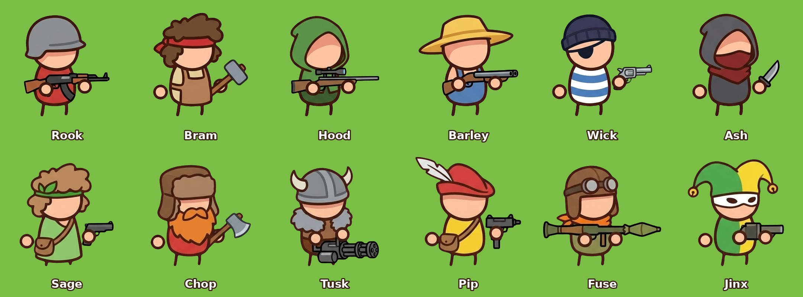
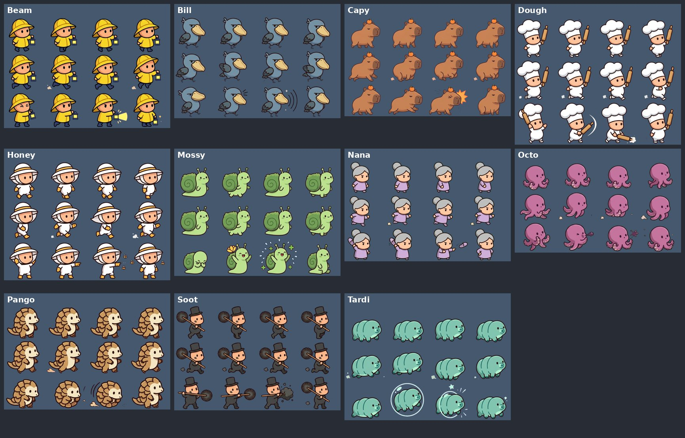
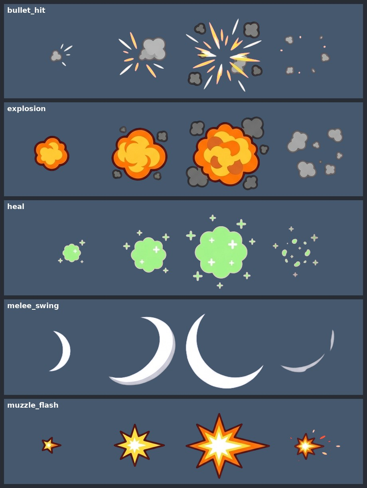
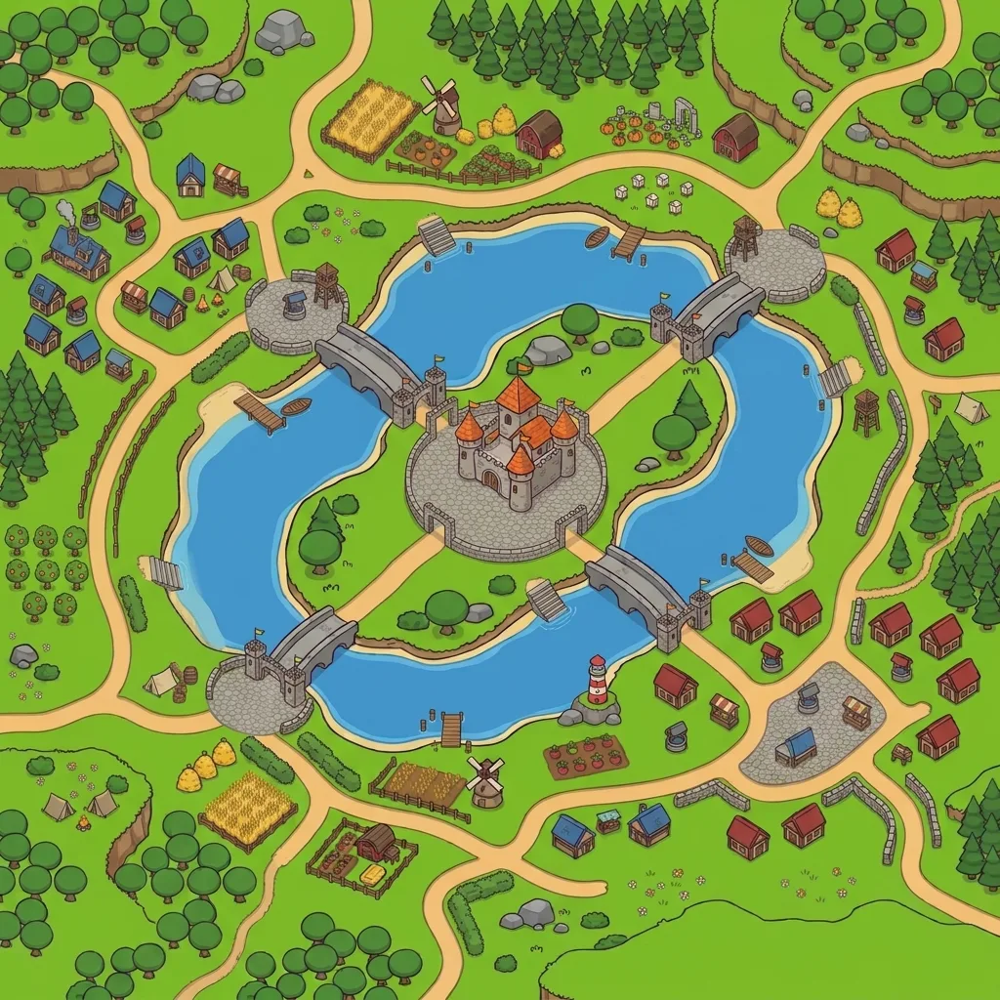
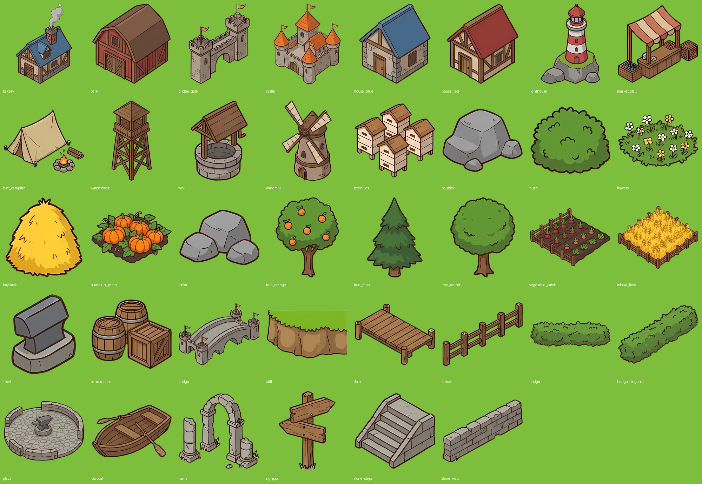

# Game_Assets2

Art assets for the brawler game.

## Folders

- `brawlers/` - the 12 brawlers, one transparent PNG each, plus `_overview.jpg`
- `animations/<Name>/` - each brawler's sprite sheets: `<Name>_sheet_right.png` and mirrored `_left.png` (transparent, 2 rows x 4 frames: row 1 walk, row 2 attack), GIFs `<Name>_walk_*`, `<Name>_run_*` (the walk played faster), `<Name>_shoot_*` (`<Name>_attack_*` for melee) and `<Name>_preview.gif`
- `weapons/` - the 12 plain weapons (side view, pointing right) and `weapons/projectiles/` (flying right)
- `effects/combat/` - muzzle flash, bullet hit, explosion, melee swing, heal (4 frames each)
- `effects/<group>/` - older generic effects: `movement`, `hit`, `defeat`, `support`, `spawn`
- `stats/brawlers.json` - every brawler's role, weapon, starting numbers and asset paths
- `maps/` - battle maps (PNG). `castle_island_map.png` is the big scrolling map (4096x4096), `castle_island_map_1024.png` is the original 1024x1024 it was upscaled from
- `maps/assets/<group>/` - the map's objects as separate transparent PNGs, in groups `buildings`, `nature` and `structures`
- `game/` - the game prototype (TypeScript + Phaser 4): the scrollable map with the 12 brawlers near the castle. See `game/README.md`
- `tools/` - the Python scripts that cut raw Gemini images into these files
- `old_roster/` - the old pet-style brawlers' animations, weapons and effects (replaced on Nov 24)

Effect files: `<name>_sheet.png` (4 frames in one strip: appear, grow, peak, fade), `<name>_1.png` to `<name>_4.png` and `<name>.gif`.

## Brawlers

Super minimal style that matches the map: a short bean body, a hat or hair over the eyes, an empty face strip,
stick legs and two floating round hands that hold a plain real-world weapon.

| Brawler | Who | Weapon | Role |
| --- | --- | --- | --- |
| Rook | castle guard | AK-47 | all-rounder |
| Bram | blacksmith | sledgehammer | tank, melee |
| Hood | forest outlaw | sniper rifle | sniper |
| Barley | farmer | double-barrel shotgun | close range |
| Wick | sailor | revolver | mid range, big hits |
| Ash | rogue | combat knife | assassin, melee |
| Sage | village healer | pistol (heals teammates) | healer |
| Chop | lumberjack | axe | bruiser, melee |
| Tusk | mercenary | minigun | heavy |
| Pip | castle messenger | Uzi | fast flanker |
| Fuse | bombardier | RPG | area damage |
| Jinx | castle jester | grenade launcher | thrower |

## Animations

Row 1 is the walk, row 2 the attack (shoot, or a swing for Bram, Ash and Chop). Everyone faces right; use the `_left` sheet for left.

## Weapons and projectiles

## Combat effects

Each frame is centered in its cell, so travel is done by moving the sprite in the game. Effects that point somewhere point right; mirror them for left.

## Map

Castle Island: the castle base on the island is where brawlers spawn, four gates and roads lead to four stone bridges, and the mainland around the lake has wide roads, ring roads, bridge plazas with watchtowers, villages (blue roofs left, red roofs right), farms, forests, cliffs and water exits (docks, beaches, stone steps).

## Map assets

38 separate objects in the style of the Castle Island map, one transparent PNG each.

| Group | Assets |
| --- | --- |
| `buildings/` | `castle`, `house_blue`, `house_red`, `bakery`, `barn`, `windmill`, `lighthouse`, `watchtower`, `market_stall`, `well`, `tent_campfire`, `bridge_gate` |
| `nature/` | `tree_round`, `tree_pine`, `tree_orange`, `bush`, `boulder`, `rocks`, `haystack`, `wheat_field`, `vegetable_patch`, `pumpkin_patch`, `beehives`, `flowers` |
| `structures/` | `bridge`, `plaza`, `stone_wall`, `fence`, `hedge`, `hedge_diagonal`, `dock`, `stone_steps`, `rowboat`, `barrels_crate`, `ruins`, `signpost`, `cliff`, `anvil` |

## Design laws

- Super minimal, like the reference cavemen: bean body, no eyes or mouth (hat or hair hides the eyes), stick legs, floating round hands, no small details.
- Thick dark brown outline, flat colors, matches the map.
- Seen a little from above, facing right (mirror for left).
- Weapons are plain real-world weapons with no skins, held low in the floating hands, never covering the face.
