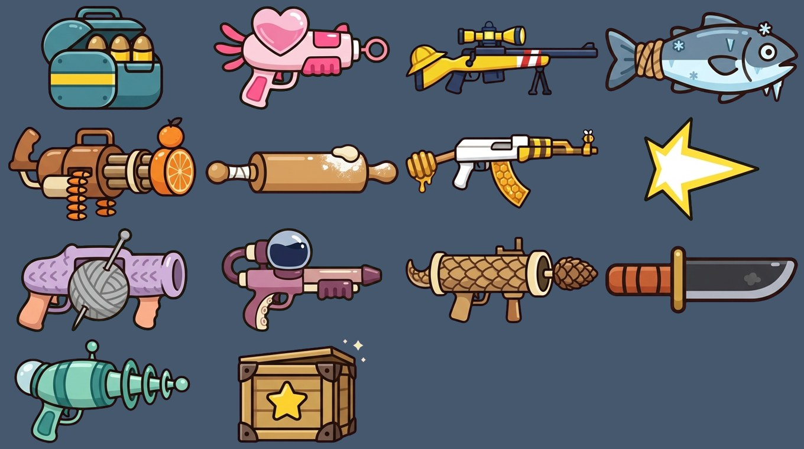
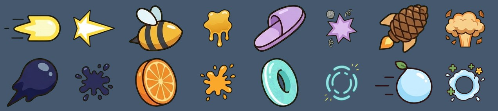
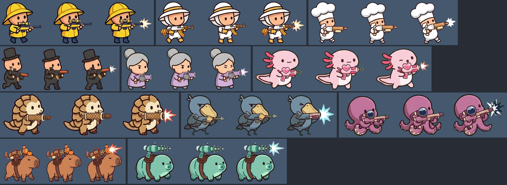
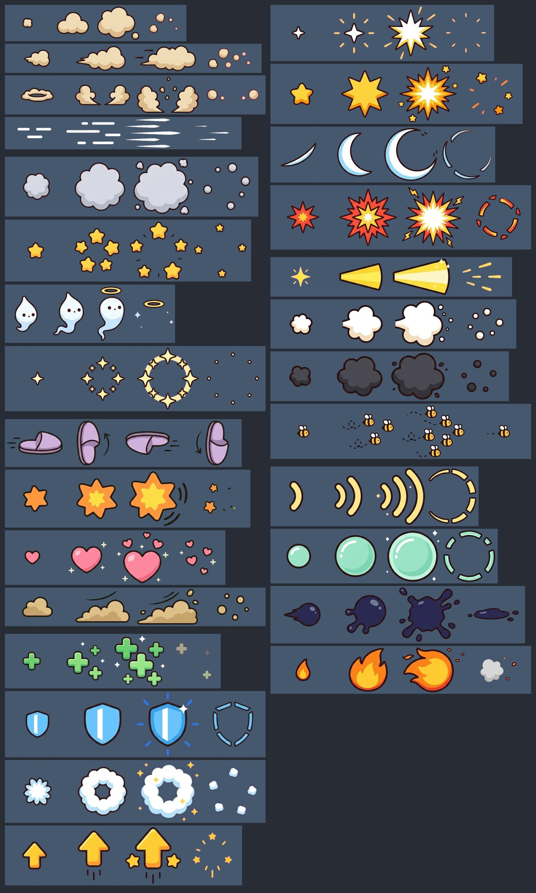

# Game_Assets2

Art assets for the brawler game.

## Folders

- `brawlers/` - character cards (one PNG per brawler, name on the card)
- `cards/` - draft pick cards (transparent PNG, one per brawler, with the count badge)
- `animations/<Name>/` - walk / run / attack sprite sheets (transparent PNG, 4 frames per row: row 1 walk, row 2 run, row 3 attack; `_right` and mirrored `_left`) plus GIF previews
- `maps/` - battle maps (PNG). `castle_island_map.png` is the big scrolling map (4096x4096), `castle_island_map_1024.png` is the original 1024x1024 it was upscaled from
- `maps/assets/<group>/` - the map's objects as separate transparent PNGs, in groups `buildings`, `nature` and `structures`
- `weapons/` - one toy blaster per brawler (transparent PNG, side view, barrel pointing right), plus `muzzle_flash.png`, `weapon_crate.png`, `ammo_box.png`
- `weapons/bullets/` - `<brawler>_bullet.png`, the projectile each gun shoots (flies to the right)
- `stats/weapons.json` - starting balance numbers and the asset paths for every weapon
- `effects/<group>/` - effect animations without characters (transparent PNG). Per effect: `<name>_sheet.png` (4 frames in one strip: appear, grow, peak, fade), `<name>_1.png` to `<name>_4.png` (single frames) and `<name>.gif` (preview)

## Brawlers

| Brawler | What it is | Role |
| --- | --- | --- |
| Beam | lighthouse keeper | long-range light beam |
| Dough | baker with a rolling pin | close-range |
| Soot | chimney sweep | fast, sneaky |
| Honey | beekeeper | long-range bees |
| Nana | grandma with a slipper | medium-range thrower |
| Capy | capybara | calm tank |
| Axo | axolotl | healer |
| Pango | pangolin | armored roller |
| Bill | shoebill | stare stun |
| Tardi | tardigrade | tank |
| Octo | octopus | ink squirt |

## Pick cards

## Animations

Every brawler has walk, run and attack rows. Nana only holds her slipper in the attack row.

## Weapons

Every brawler has its own gun, skinned in its own colors.

| Brawler | Weapon | Shoots | Style |
| --- | --- | --- | --- |
| Beam | Lighthouse Sniper | light bolt | long range, slow, big hits |
| Bill | Fish Harpoon Gun | fish harpoon | long range, short stun |
| Pango | Pinecone Bazooka | pinecone rocket | long range, splash |
| Honey | Honeycomb AK | bee bullet | mid range, steady |
| Soot | Chimney SMG | soot pellet | mid range, fast |
| Tardi | Ray Gun | plasma ring | mid range, steady |
| Octo | Ink Soaker | ink blob | mid range, slows |
| Nana | Slipper Launcher | slipper | mid range, small splash |
| Dough | Rolling-Pin Shotgun | dough balls | short range, strong up close |
| Capy | Citrus Minigun | orange slices | heavy, spin-up, slow walk |
| Axo | Bubble Blaster | heart bubble | support, heals teammates |

Bullets and their hit effects (hit effects are in `effects/weapons/`):

Armed animations are in `animations/<Name>/`: `<Name>_armed_sheet_right.png` and `_left.png`
(2 rows x 4 frames: row 1 walk with the gun, row 2 shoot: aim, fire with muzzle flash, recoil, back to aim),
GIFs for walk, run (the walk frames played faster) and shoot, and `<Name>_armed_preview.gif` (shot, bullet, hit).
The brawlers were redrawn holding their guns in both hands. Capy and Tardi walk on four legs, so their
guns are strapped on their backs.

## Effects

| Group | Effects |
| --- | --- |
| `movement/` | `walk_dust`, `run_dust`, `landing_puff`, `speed_lines` |
| `hit/` | `hit_spark`, `impact_burst`, `slash_arc`, `critical_hit` |
| `defeat/` | `smoke_poof`, `star_pop`, `soul_wisp`, `sparkle_ring` |
| `attacks/` | `beam_light`, `dough_flour`, `soot_cloud`, `honey_bees`, `nana_slipper`, `capy_bonk`, `axo_heart`, `pango_dust`, `bill_shockwave`, `tardi_bubble`, `octo_ink` |
| `support/` | `heal_sparkles`, `shield_up`, `spawn_poof`, `level_up` |
| `weapons/` | `<brawler>_hit` for all 11 guns (3 frames: small, full, fading) |
| `spawn/` | `spawn_poof_white`, `spawn_poof_blue` (blue team), `spawn_poof_red` (red team), `spawn_poof_dust` (unit lands on the ground) |

Each frame is centered in its cell, so travel (a slipper flying, a soul floating up, a beam moving right) is done by moving the sprite in the game. Effects that point somewhere point right; mirror them for left.

## Map

Castle Island: the castle base on the island is where brawlers spawn, four gates and roads lead to four stone bridges, and the mainland around the lake has wide roads, ring roads, bridge plazas with watchtowers, villages (blue roofs left, red roofs right), farms, forests, cliffs and water exits (docks, beaches, stone steps).

## Map assets

38 separate objects in the style of the Castle Island map, one transparent PNG each.

| Group | Assets |
| --- | --- |
| `buildings/` | `castle`, `house_blue`, `house_red`, `bakery`, `barn`, `windmill`, `lighthouse`, `watchtower`, `market_stall`, `well`, `tent_campfire`, `bridge_gate` |
| `nature/` | `tree_round`, `tree_pine`, `tree_orange`, `bush`, `boulder`, `rocks`, `haystack`, `wheat_field`, `vegetable_patch`, `pumpkin_patch`, `beehives`, `flowers` |
| `structures/` | `bridge`, `plaza`, `stone_wall`, `fence`, `hedge`, `hedge_diagonal`, `dock`, `stone_steps`, `rowboat`, `barrels_crate`, `ruins`, `signpost`, `cliff`, `anvil` |

## Design laws

- Minimal: one simple blob body, dot eyes, no small details.
- 3 colors per brawler plus the dark outline.
- 3/4 side view facing right (mirror the image for left).

Note: the `brawlers/` PNGs are screen captures (about 507x681); 
