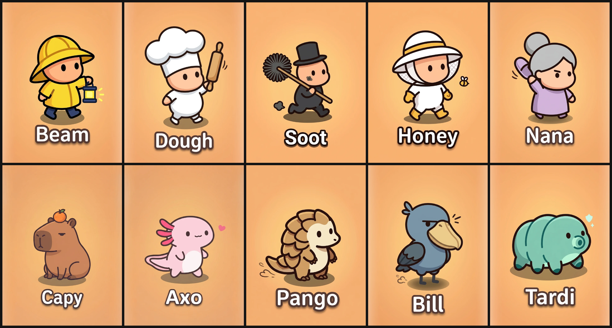
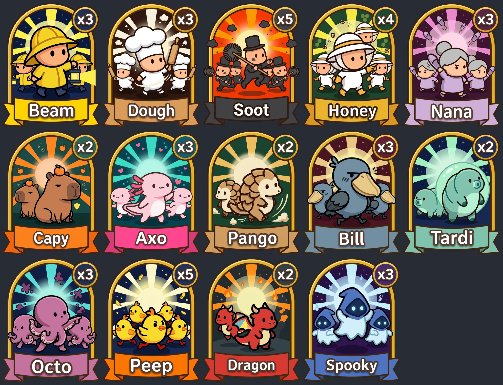

# Game_Assets2

Art assets for the brawler game.

## Folders

- `brawlers/` - character cards (one PNG per brawler, name on the card)
- `cards/` - draft pick cards (transparent PNG, one per brawler, with the count badge)
- `animations/<Name>/` - walk / run / attack sprite sheets (transparent PNG, 4 frames per row: row 1 walk, row 2 run, row 3 attack; `_right` and mirrored `_left`) plus GIF previews
- `effects/` - attack and ability effects (coming)

## Brawlers

| Brawler | What it is | Role |
| --- | --- | --- |
| Beam | lighthouse keeper | long-range light beam |
| Dough | baker with a rolling pin | close-range |
| Soot | chimney sweep | fast, sneaky |
| Honey | beekeeper | long-range bees |
| Nana | grandma with a slipper | medium-range thrower |
| Capy | capybara | calm tank |
| Axo | axolotl | healer |
| Pango | pangolin | armored roller |
| Bill | shoebill | stare stun |
| Tardi | tardigrade | tank |
| Octo | octopus | ink squirt |
| Peep | chick | swarm pecker |
| Dragon | baby dragon | fire puff |
| Spooky | hooded ghost | boo scare |

## Pick cards

## Design laws

- Minimal: one simple blob body, dot eyes, no small details.
- 3 colors per brawler plus the dark outline.
- 3/4 side view facing right (mirror the image for left).

Note: the current card PNGs are screen captures (about 507x681). Full-size originals are in Gemini.
